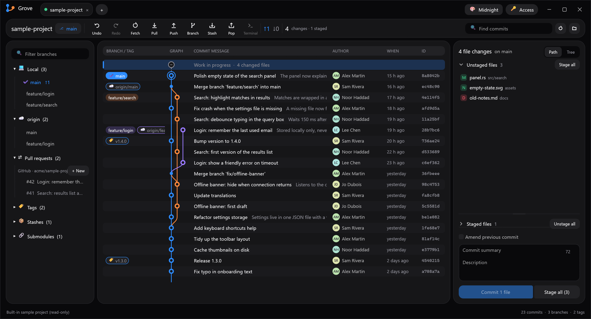

# Vegit

A fast, friendly desktop Git client written in Rust with [egui](https://github.com/emilk/egui) (eframe).
No AI features, no account, no subscription: it drives your own `git` install, so credentials,
hooks, config and SSH keys behave exactly as they do in a terminal.



## Features

- **Commit graph**: branches, tags, remotes and merges laid out in stable lanes, with commit search.
  Loads the last 3,000 commits so refreshes stay quick.
- **Staging**: stage, unstage or discard files one by one, in bulk or by folder (path or tree view),
  and stage or unstage single hunks.
- **Diffs**: unified or split view, virtualized so huge diffs (Unity scenes, big asset imports) stay smooth.
  Image changes (PNG, JPEG, GIF, WebP, BMP, ICO, TGA, SVG) can be rendered side by side.
- **Commit**: summary and description, amend the previous commit, undo / redo the last commit.
- **Branches and remotes**: create, check out (local or remote), fetch, pull, push (with force), stash and pop.
- **File history and blame** for any file.
- **Merge conflicts**: resolve a conflicted file with "ours" or "theirs".
- **Pull requests** on GitHub, GitLab (including self-hosted), Bitbucket Cloud and Azure DevOps:
  list, check out and create them (drafts too).
- **Private repositories**: sign in with a token saved through git's credential helper
  (Git Credential Manager on Windows), or generate an SSH key. The app never stores secrets itself.
- **Tabs** for several repositories, clone / init / open, submodules, "open in terminal / file explorer".
- **Themes**: Midnight, Dracula, Monokai, Nord, Dusk, Paper (light) and Solarized (light).
- **Non-blocking UI**: git runs on a worker thread and network operations on their own threads,
  so the window never freezes.

A read-only sample project is built in, so the first screen shows a realistic graph before you open anything.

## Requirements

- [Git](https://git-scm.com/) on your `PATH`.
- [Rust](https://rustup.rs/) 1.85 or newer (the crate uses the 2024 edition).

Developed and tested on Windows; eframe also targets macOS and Linux.

## Build and run

```bash
cargo run --release
```

Open a repository directly:

```bash
cargo run --release -- path/to/repository
```

Save a screenshot of the sample project and exit (handy for checking the UI in CI):

```bash
cargo run --release -- --screenshot out.png
```

Keyboard shortcuts: `F5` refreshes, `Ctrl+Enter` commits, `Esc` closes the open diff or dialog.

## Tests

```bash
cargo test
```

The tests run the git layer against throwaway repositories in the temp folder (log, refs and status
parsing, hunk staging, graph layout). One test lists the open pull requests of a public GitHub
repository and needs network access.

## Project layout

| File | Role |
| --- | --- |
| `src/main.rs` | Entry point and command-line arguments |
| `src/app.rs` | Application state, action queue and the git operations behind every button |
| `src/git.rs` | Thin layer over the `git` command line |
| `src/graph.rs` | Lane layout for the commit graph |
| `src/diff.rs` | Unified diff parsing into hunks |
| `src/preview.rs` | Before / after image rendering |
| `src/forge.rs` | Pull requests on GitHub, GitLab, Bitbucket and Azure DevOps |
| `src/access.rs` | Credentials and SSH keys for private repositories |
| `src/theme.rs` | Color palettes and fonts |
| `src/ui*.rs` | Window, sidebar, graph and detail panels |
| `src/demo.rs` | Built-in sample repository |
